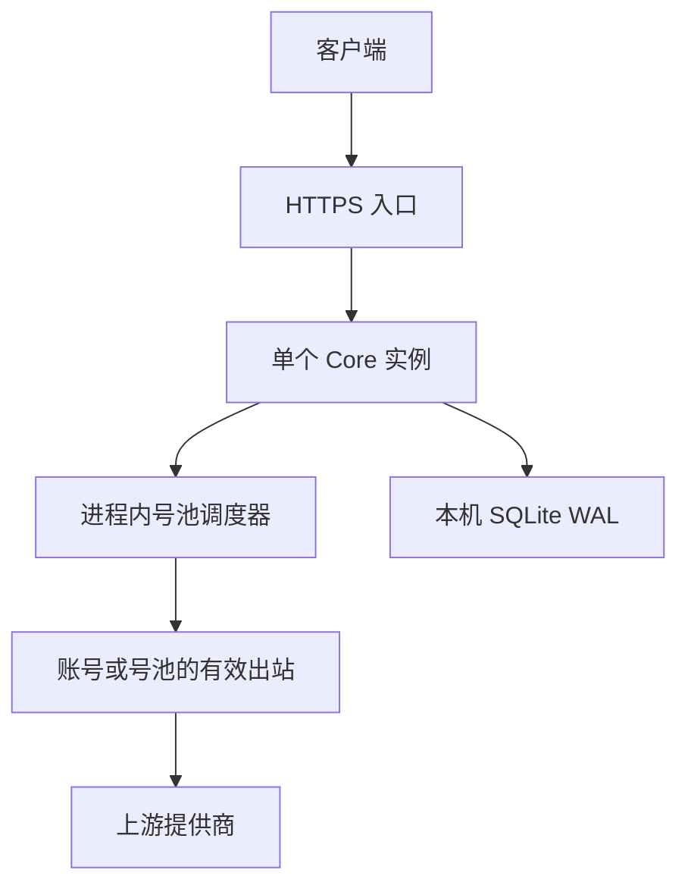
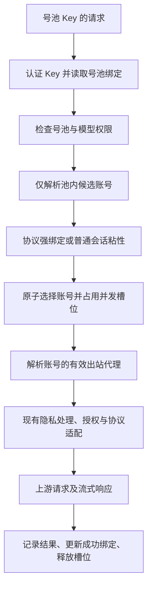

# 订阅号池与 Key 绑定开发设计

<!-- markdownlint-configure-file { "MD013": { "tables": false } } -->

状态：初版方案已定，待实现。本文是开发基线，不表示相关接口或界面已经可用。

代码基线：`902a935`（`feat: 接入 Kiro`）。

初版采用单个 Core 实例和 SQLite，服务器与桌面复用现有存储后端。

容量目标为约 1,000 个同时进行的推理请求，包含长流式请求；是否达标以单实例压测为准，不等同于每秒 1,000 个请求。

多实例、高可用接管和更换数据库不属于初版范围。初版不为这些后续能力预先引入分布式协调组件。

## 1. 目标与范围

将号池作为管理员显式创建的资源，用于集中管理同一订阅提供商的多个账号。客户端通过访问 Key 选择号池，由号池完成账号选择、会话粘性、并发控制和出站代理解析。

典型配置：

| 号池          | 订阅类型      | 成员                | 绑定的 Key         |
| ------------- | ------------- | ------------------- | ------------------ |
| Claude 号池 A | `claude_code` | Claude 账号 1、2、3 | 开发机 Key、CI Key |
| Kiro 号池 B   | `kiro`        | Kiro 账号 1、2、3   | 工作站 Key         |

已确定的产品要求：

- 新建号池时选择订阅提供商，同一个池只包含该提供商的账号。
- Claude 号池只支持直接 HTTP 连接，不纳入 Claude Code CLI 模式。
- 创建 Key 时选择绑定的号池；多个 Key 可以使用同一个池。
- 新会话尽量分散到不同账号，不能按“耗尽账号 A，再使用账号 B”调度。
- 已有会话优先复用原账号，同时遵守账号并发上限。
- 任一适用的 5 小时或周额度耗尽时，账号进入额度冷却，普通请求可以切换到池内其他账号。
- 号池可以配置 SOCKS5 出站；单个账号也可以配置自己的代理并覆盖号池设置。
- 登录、令牌刷新、模型发现、额度查询和推理使用一致的有效出站策略。
- 单个 Core 统一维护号池调度状态，配置、成功会话绑定和额度冷却持久化到 SQLite。
- 容量验收以单实例约 1,000 个同时进行的推理请求为目标，不包含节点故障接管。

本文采用的第一版设计决定：

- 一个号池 Key 绑定一个号池，一个账号最多属于一个号池。
- 号池内可以包含不同套餐的同类订阅账号，不按套餐强制拆池。
- 号池 ID 稳定，改名不改变成员、Key 绑定或会话归属。
- 普通并发拥堵先有界排队，不为了平衡瞬时负载频繁迁移会话。
- 账号失效等故障允许在同一个池内切换；协议强绑定请求另行处理。
- 使用进程内原子准入、并发计数、有界队列和轮询游标，不使用数据库逐请求争抢执行租约。
- 保留现有全局路由 Key，新增显式绑定号池的 Key；号池 Key 永远不能回退全局路由。
- 号池内账号继承其池的代理，账号自定义代理或显式直连优先于继承设置。

本次不包含注册账号、租户计费、充值、套餐售卖和跨提供商自动切池。现有提供商协议适配继续复用，包括 Kiro 的
`adapter` 协议标记。

## 2. 当前代码与目标的差异

| 当前能力                                    | 目标改动                                                         |
| ------------------------------------------- | ---------------------------------------------------------------- |
| `Service` 表示提供商实例，订阅服务对应账号  | 继续作为账号实体，号池通过成员关系引用 `ServiceID`               |
| `ServicePackage` 按提供商和套餐自动派生分组 | 新增显式号池；套餐分组只用于展示，不承担 Key 授权或号池成员关系  |
| 路由根据服务顺序及缓存额度排序              | 绑定池的请求使用池内并发调度，不能再次被全局套餐排序覆盖         |
| Key 用于认证和请求归属                      | 增加明确的范围及 `pool_id`，认证后建立不可被客户端覆盖的路由范围 |
| 普通会话绑定按 Key、会话、模型和协议隔离    | 增加号池范围及绑定变更校验，复用现有会话识别                     |
| 账号已有 `inherit/direct/custom` 代理配置   | 增加号池代理层，`inherit` 先查所属号池，再查全局                 |
| 有后台额度监控、风险暂停、重试和冷却        | 复用这些机制；额度作为可用性依据，不作为消耗账号的优先级         |
| 入口解析有并发限制                          | 新增覆盖整个推理生命周期的账号并发槽位                           |

当前额度监控通常每账号约五分钟查询一次，失败后退避，且逐账号查询。额度快照不等于实时剩余额度，也不等于当前并发负载。

现有入口解析许可在转发之前释放，不能直接作为账号并发计数。

现有 SQLite
WAL、写入协调、凭据加密和进程内令牌刷新机制继续使用。不因新增号池重写全部存储层，也不把 PostgreSQL 或 Redis 设为前置依赖。

Claude 号池只复用直接连接路径，账号的 OAuth 凭据由 AstrLink 管理并用于 HTTP 转发。现有 CLI 功能不属于本次号池开发范围，不在本次删除或改造。

## 3. 资源与数据模型

下列名称和字段作为初版契约，实施时同步更新 Go、TypeScript、Tauri 桥接和 OpenAPI。

### 3.1 号池

新增 `AccountPool`：

| 字段                       | 含义                                         |
| -------------------------- | -------------------------------------------- |
| `id`                       | 稳定资源标识，例如 `pool_claude_a`           |
| `name`                     | 管理界面名称                                 |
| `provider`                 | 订阅提供商，例如 `claude_code` 或 `kiro`     |
| `enabled`                  | 是否接收新的推理请求                         |
| `sticky`                   | 会话粘性开关及闲置 TTL，复用现有粘性设置语义 |
| `queue`                    | 最大等待请求数和等待超时                     |
| `proxy`                    | 号池出站配置，凭据与公开配置分开存储         |
| `created_at`、`updated_at` | 创建和更新时间                               |

第一版只实现一个明确的调度策略：最少并发占用比例，平局轮询。不预先引入策略插件、脚本、自定义权重或多套未使用的算法。

`provider`
创建后不可修改。需要更换订阅类型时创建新池。关闭号池只阻止推理准入，不阻止管理员进行账号登录、诊断和额度查询。

### 3.2 成员关系

新增 `AccountPoolMember`：

| 字段                      | 含义                                         |
| ------------------------- | -------------------------------------------- |
| `pool_id`                 | 所属号池                                     |
| `service_id`              | 现有订阅账号 ID                              |
| `enabled`                 | 该成员是否参与推理调度                       |
| `max_concurrent_requests` | 此账号允许同时执行的推理请求数，必须为正整数 |

数据库对 `service_id`
设置唯一约束，保证一个账号最多加入一个池。账号可以尚未登录就加入池，但只有满足可用性条件的成员可以接收推理请求。

成员提供商必须与号池一致；不复制账号的凭据、模型列表和风险状态。

Claude 成员的有效接入模式必须为直接连接。CLI 模式账号加入池时明确拒绝，不能静默转换模式或提取 CLI 凭据。已入池账号不能直接改为 CLI 模式，须先停用并移出池。

并发限制的运行时计数以 `service_id`
为键，同一账号被不同 Key 使用时共享上限。不得把并发上限按 Key 分别计算，也不得通过多个
`ServiceID`
重复导入同一凭据绕开限制。现有凭据结构若不能可靠识别同一上游账号，应明确这一限制，不通过猜测令牌内容实现去重。

### 3.3 Key 与号池绑定

访问令牌元数据新增明确的 `routing_scope` 和
`pool_id`，Key 的明文、哈希查找和保密存储机制不变。

| `routing_scope` | `pool_id`          | 行为                                        |
| --------------- | ------------------ | ------------------------------------------- |
| `global`        | 必须为空           | 沿用现有全局路由，用于原有普通 API 服务访问 |
| `pool`          | 必须指定存在的号池 | 只在该池内路由，不回退全局                  |

- 新建 Key 时显式选择全局路由或一个号池，不能把缺失字段解释为全局权限。
- 号池 Key 绑定一个池；多个 Key 可以绑定同一个池。
- 已禁用号池可以保留既有绑定，但请求返回号池不可用。
- 修改绑定不改变 Key 的明文；修改后新请求按新范围授权。
- 修改绑定、删除 Key、改变成员关系时，唤醒并重新检查受影响的排队请求。
- 修改前已执行的请求可以完成；尚未开始上游尝试的请求必须重新检查授权。
- 删除仍被 Key 引用的池返回冲突；先改绑或删除这些 Key。

客户端传入的池 ID、服务 ID、路由提示或历史响应 ID 均不能扩大 Key 的可访问范围。号池 Key 的模型目录限定在池内，暂时并发繁忙不应使模型从目录中消失。

全局路由也不能绕过池成员的并发和额度冷却检查。

若全局路由选中了一个已入池账号，仍通过该账号的唯一调度状态获取许可，并使用账号→所属池→全局的代理解析规则。

全局路由既有的账号选择策略保留；本方案的新会话分散策略应用于号池 Key。

### 3.4 持久化与运行时状态

SQLite 持久化号池配置、成员关系、Key 范围、代理凭据引用、成功会话绑定、额度冷却和请求记录。额度冷却记录耗尽窗口、观测时间、可信重置时间及信号来源，重置时间允许未知。复用或扩展现有存储契约，不建立第二套凭据或账号实体。

仅在当前 Core 进程内维护：

- 账号进行中请求计数和幂等执行许可。
- 池内轮询游标、等待队列及通知。
- 尚未成功的会话临时归属。
- 半开探测互斥和正在执行的额度复查。

请求体和流式连接不写入可重放的任务队列；初版不增加执行租约表、心跳或跨节点所有者。

重启后运行时计数从零开始，不把中断前的记录当作仍在执行的许可，也不自动重放旧请求。

持久化的配置、成功绑定及额度冷却继续加载；使用绑定前仍检查 TTL 和账号可用性。

配置写入先完成 SQLite 事务，再原子发布进程内配置快照并唤醒受影响的等待者，之后控制 API 才返回成功。发布失败时暂停相关资源的新准入并重新加载，不能在修改已返回成功后继续使用旧权限。调度锁内不执行数据库、网络或隐私模型操作。

配置同步和备份恢复应保留池、成员和 Key 的引用关系；缺失依赖的号池 Key 不能回退全局路由。

### 3.5 单实例部署结构



一个数据目录只运行一个 Core，启动时应检测并阻止重复启动。服务器将数据目录持久化到本机磁盘或本地卷，不通过共享 SQLite 文件部署多个服务副本。凭据继续使用本地密钥及现有加密存储，备份必须包含解密所需密钥。

服务管理器负责进程退出后的重启。重启期间服务不可用、已有流可能中断，这是初版明确的运行边界。不宣称故障无损接管，也不增加数据库主从、Redis、消息中间件或跨节点内部转发。

## 4. 请求路径与授权边界



认证后按 `routing_scope`
显式进入全局路由或号池路由，下面的处理流程以号池 Key 为准。全局路由不是号池路径的失败回退分支。

请求先完成认证及必要的模型、协议、会话元数据解析，再进入号池准入。排队不能长期占用入口解析许可；昂贵的隐私检测、转换和上游调用应在获得执行资格后进行。

保持现有隐私检查顺序和失败处理，不得因为增加调度而绕过检查。

池范围必须贯穿以下路径：

- 普通推理、流式推理和 Responses WebSocket。
- 模型发现、模型重定向和协议转换后的候选选择。
- 指定服务、普通会话粘性、`previous_response_id` 及恢复重试。

故障恢复只能从已经过池范围过滤的候选中选择。不得在重试耗尽、池禁用、池配置读取失败或没有可用账号时重新使用全局服务列表。

管理面主动连接测试仍使用管理员权限，并与推理 Key 的授权范围区分。

## 5. 池内调度

### 5.1 可用性筛选

账号必须同时满足：

1. 号池、成员和对应服务均已启用。
2. 账号已连接，凭据可用于授权。
3. 接入模式属于初版支持范围，并支持请求模型及实际执行所需的协议转换路径。
4. 没有处于暂停、失效或当前路由的冷却状态。
5. 没有明确的额度耗尽信号。

额度未知不能直接视为额度为零，也不能视为额度无限。使用最近快照和实时上游拒绝信号维护额度冷却，由现有监控机制驱动复查。

完成可用性筛选后，再根据并发槽位决定立即执行还是等待。余额多寡、套餐价格和接近重置时间均不参与第一版负载排序。

### 5.2 额度耗尽、冷却与恢复

5 小时额度和周额度分别跟踪，只要任一适用窗口耗尽，就停止向该账号分配新的推理请求。两类窗口都适用时，不能因为 5 小时额度已经恢复就忽略仍然耗尽的周额度。

使用提供商实际报告的窗口类型、时长和限制范围，不把所有提供商的
`primary/secondary`
固定解释成 5 小时/周。其他提供商的月度额度或积分额度按其真实语义处理。

| 账号状态                              | 调度处理                                                         |
| ------------------------------------- | ---------------------------------------------------------------- |
| 5 小时额度耗尽、周额度可用            | 账号进入额度冷却，请求选择池内其他可用账号                       |
| 周额度耗尽、5 小时额度可用            | 账号进入额度冷却，不能靠短窗口重置提前恢复                       |
| 两个窗口均耗尽                        | 所有阻塞窗口解除后才恢复；已知恢复时间取这些窗口重置时间的较晚值 |
| 已确认耗尽，但恢复时间未知            | 保持冷却，通过额度查询及受控复查确认恢复，不猜测固定恢复时间     |
| 所有符合模型/协议要求的账号均额度冷却 | 返回 `pool_quota_exhausted`，不让请求排队等待数小时或数天        |

耗尽信号可以来自可信的额度快照、提供商的额度拒绝错误或响应头。普通瞬时 429、并发限制和上游过载不能被直接判断为 5 小时或周额度耗尽。

提供商明确报告仅限某模型的限制时沿用路由级冷却，不把它扩大成全账号周额度耗尽。

检测到账号额度耗尽后：

1. 立即在调度器内禁止该账号后续准入，再将冷却写入 SQLite；写入失败保留内存冷却并记录错误。
2. 唤醒等待该账号的请求；普通会话重新参与池内选择，不继续等待耗尽账号的并发空位。
3. 当前尝试收到额度拒绝时，先结束旧尝试并释放槽位，再按现有重试预算申请其他账号。
4. 只有请求可重放且尚未向客户端输出响应时，才透明切换当前请求；协议强绑定仍按第 6.3 节处理。
5. 新账号成功后更新普通会话绑定，原账号恢复时不把已迁移会话强行迁回。

额度冷却保持账号已登录状态，不等同于凭据失效、封禁或需要重新授权。

其他已经执行中的请求不因收到一条额度信号而被无条件中断；它们完成时也不能用旧快照清除新冷却状态。

恢复以提供商证据为依据：

- 优先使用上游报告的 `reset_at`，或以观测时间加 `reset_after_seconds`
  计算复查时间。
- 到达重置时间只是恢复检查的时机，不能仅将历史使用率改为零就直接解除冷却。
- 有独立额度接口时，复查全部阻塞窗口，确认恢复后重新参与调度；查询失败继续退避。
- 没有独立额度接口但有可信重置时间时，到期最多允许一个半开探测请求。探测使用正常客户端请求，仍受池授权和账号并发限制，不额外生成推理内容。
- 探测期间其他请求继续使用池内其他账号；若仍收到额度拒绝，更新冷却后再次等待。
- 半开探测和额度复查在当前进程内按账号互斥，避免定时任务与手动刷新重复触发。
- 缺少可信恢复时间且不能查询时，保持冷却，允许管理员显式发起受控复查。
- 恢复只能清除相应额度冷却，不能清除人工停用、凭据失效或其他风险暂停。
- 重启加载冷却记录并复查，不能通过进程重启把所有账号直接恢复为可调度。

若全池额度耗尽且存在可信的恢复时间，`Retry-After`
可参考最早可能恢复的合格账号。每个账号须先计算全部阻塞窗口的恢复条件，再比较账号之间的恢复时间，不能直接取所有窗口的最早时间。

### 5.3 新会话的负载分流

对可用且有空位的账号计算：

```text
负载 = 当前进行中的推理请求数 / 账号并发上限
```

选择负载最低的账号，负载相同时使用池内轮询游标选择。游标在成功占用槽位后推进。不能每次按固定数组顺序或账号 ID 选择，也不根据剩余额度优先耗尽某个账号。可以用整数交叉相乘比较负载比例。

三个同等容量且空闲的账号接收三个新会话，应分配到不同账号。即使新会话串行到达、每次选择时全部空闲，也应轮流分配。

### 5.4 原子准入与释放

读取负载、选择账号、占用槽位和登记临时会话归属，在同一次进程内同步操作中完成。

使用职责集中的调度器和短临界区，按池组织调度状态；不得持有全局锁执行慢操作。

同一账号的所有推理入口共用计数，包括其他 Key、全局路由和控制面连接测试。

本地模型目录、登录、刷新和额度查询不占推理槽位，继续使用各自受限的后台调用机制。

执行许可只能有效释放一次：

- 授权、隐私检查或转换失败时释放尚未发起的占用。
- 普通请求在上游响应处理结束后释放。
- SSE 覆盖整条流，结束、关闭或取消完成后释放，不能收到响应头就释放。
- WebSocket 按推理回合计数，空闲连接不占槽位，但保留协议强绑定。
- 客户端断连取消上游读取，清理完成后释放并通知等待者。
- 切换账号先结束旧尝试并释放旧许可，再申请新许可；同一请求不同时占用多个账号。
- 重试退避期间不占槽位，下次尝试重新准入，并遵守原请求的期限和尝试预算。

不得让两条并发请求同时读取同一空位后分别放行，也不得因重复 Close 或取消导致计数为负。不使用 SQLite 事务、逐请求数据库计数或分布式租约代替进程内准入。

降低账号上限时不强行取消已开始请求，暂停新准入直到计数满足新上限。移除或转移成员前先禁用并等待正在执行的请求结束，不边运行边改变其归属。

### 5.5 单实例生命周期

正常停机时停止新准入，取消等待者，并在有上限的时间内排空活动请求。到期未结束的流明确中断，关闭上游连接并释放本实例的请求资源。

进程异常退出后不从请求记录重建执行队列，不自动重试可能已经在上游执行的请求。启动时完成既有 Core 初始化并校验持久化配置后再进入就绪状态。账号额度冷却独立持久化，不能通过重启清除。

本地取消连接不保证上游已经停止计算，不能承诺上游操作 exactly-once。结果未知的请求保留明确记录，不对客户端已收到的内容自动重放或拼接。

## 6. 会话粘性与排队

### 6.1 普通会话绑定

绑定范围为：

```text
pool_id + access_token_id + session_id + 请求模型 + 协议族
```

复用现有会话解析和协议族归一化，不新增依赖原始提示词的会话识别算法。两个 Key 即使提交相同会话标识，也不能共享账号绑定。

- 原账号可用且有槽位：继续使用原账号。
- 原账号仅并发已满：等待原账号，不因另一个账号暂时空闲而立即换号。
- 原账号被停用、移出池、凭据失效、额度耗尽或进入冷却：按池内故障切换处理。
- 额度冷却解除普通粘性的优先选择约束；排队中的普通会话也可以改选其他账号。
- 成功完成请求后才创建或延长持久化绑定；失败和取消不刷新 TTL。
- 正常成功请求不能触发后台“重新均衡”而迁移已有会话。

两个并发的首次请求可能具有同一会话范围，必须共享一个临时账号归属，不能各自选中不同账号。

临时归属在调度器中按同一会话范围互斥创建，成功后更新为持久化绑定。

同一新会话的并发请求复用临时归属，失败清理时检查其他尚未结束的尝试。

使用绑定版本或等价条件更新，防止改绑、解绑或故障切换后的旧请求重新写回旧账号。

### 6.2 有界等待

池同时设置最大排队数和等待超时，不能无限等待。

- 已绑定会话等待指定账号；新会话可以等待任意合格账号。
- 队列满时立即拒绝；等待超时返回繁忙，第一版不因排队超时自动迁移普通会话。
- 排队期间监听客户端取消、Key 失效、池关闭和成员配置变化。
- 账号进入额度冷却时唤醒等待者，改选其他合格成员；全池额度耗尽则结束等待并返回额度错误。
- 账号释放槽位后，优先处理已等待且可执行的请求。
- 等待繁忙账号的队首不能阻挡可以使用其他空闲账号的请求；同一账号的等待者保持公平性。
- 唤醒后重新检查当前授权和账号可用性，不能使用入队时已经失效的候选。
- 等待时间计入总请求期限；重试不能反复重置期限形成无限等待。

除每池队列长度外，还限制整个进程的等待请求数和排队请求体字节数。不得无界缓存大请求体；等待队列只存本进程请求引用、目标范围、到达顺序和截止时间。

计数唤醒、取消和关闭使用上下文及通知机制，不为每个等待者启动轮询 goroutine。账号释放、冷却和配置变更时重新检查可执行等待者；重启后不恢复等待队列。

### 6.3 协议强绑定

`previous_response_id`、已建立的 Responses WebSocket 等继续遵守现有强绑定约束。

- 强绑定优先于负载排序，但不能越过 Key 的号池权限。
- 原账号繁忙时可以等待；不可用或等待超时则返回明确错误。
- 不能将原账号生成的响应 ID 发送到另一个账号。
- Key 改绑或账号移出池后，旧续接引用不能访问原池。
- 流式响应已向客户端输出后，不得透明切换账号重放并拼接两条结果。

## 7. 号池与账号出站代理

### 7.1 继承规则

优先级固定为：账号设置 → 号池设置 → 全局设置。

| 配置位置 | `inherit`                    | `direct`           | `custom`                     |
| -------- | ---------------------------- | ------------------ | ---------------------------- |
| 账号     | 查所属号池，无所属池时查全局 | 明确直连，停止继承 | 使用账号自己的代理，停止继承 |
| 号池     | 查全局                       | 明确直连，停止继承 | 使用号池代理，停止继承       |

沿用现有 `ServiceProxy` 的模式名称，不增加 `socks5_override`
等重复模式。SOCKS5 通过 `custom`
的地址协议表达；现有 HTTP/HTTPS 代理能力保留。账号 `proxy`
未设置的行为等同于继承，明确直连必须写为 `direct`。

例如池 A 使用代理 P1：账号 1 继承时走 P1，账号 2 指定 P2 时走 P2，账号 3 直连时不走代理。

### 7.2 所有账号通信使用统一解析器

在现有 `networkproxy.Resolver` 基础上扩展池查询，按 `service_id`
找到成员关系。后台刷新和额度监控没有客户端 Key，也必须能得到相同的有效代理。

统一覆盖：设备登录、浏览器授权交换、令牌刷新、模型发现、额度/资料查询、推理、重试和 WebSocket。

浏览器打开上游授权页面使用的是浏览器自身网络；该浏览器流量不属于服务器能够代理的 HTTP 请求。

SOCKS5 连接应将上游域名交给代理解析，不提前在服务器解析上游目标域名。代理服务器自身域名的解析与上游目标域名解析应区分。

代理不可达、认证失败或凭据缺失时明确失败，不能悄悄回退到直连或另一层代理。

### 7.3 凭据及配置变更

- 代理认证信息通过已有密钥存储加密保存，不能嵌在公开 URL、号池配置响应或日志中。
- 号池代理凭据使用独立资源引用，例如
  `local://pool-proxy/<pool_id>`；不要伪装成服务 ID。
- 配置响应只提供凭据是否存在等状态；沿用已有只写凭据更新和明确删除的语义。
- 每次新操作冻结有效代理快照；一次登录的轮询和授权交换使用同一个快照。
- 配置更新后，新操作使用新代理；正在执行的流继续使用原快照直到完成或取消。
- 有效地址或凭据变化时更新连接池标识并关闭旧空闲连接，不能复用旧代理的空闲连接。
- 代理测试、账号连接测试和实际推理使用相同解析路径。

## 8. 控制 API 与错误语义

### 8.1 新增及扩展的接口

| 方法与路径                                                             | 用途                                        |
| ---------------------------------------------------------------------- | ------------------------------------------- |
| `GET /control/v1/account-pools`                                        | 号池列表及概要                              |
| `POST /control/v1/account-pools`                                       | 创建号池                                    |
| `GET /control/v1/account-pools/{id}`                                   | 读取配置、成员及 ETag                       |
| `PATCH /control/v1/account-pools/{id}`                                 | 修改配置，使用 `If-Match`                   |
| `PUT /control/v1/account-pools/{id}/members`                           | 原子替换成员配置，使用号池 ETag             |
| `DELETE /control/v1/account-pools/{id}`                                | 删除无 Key 引用且无执行/等待请求的池        |
| `POST /control/v1/account-pools/{id}/members/{service_id}/quota-probe` | 允许下一条正常客户端请求做一次受控额度探测  |
| `GET /control/v1/access-tokens/{id}`                                   | 读取 Key 范围及强 ETag                      |
| `POST /control/v1/access-tokens`                                       | 创建 Key，增加 `routing_scope` 和 `pool_id` |
| `PATCH /control/v1/access-tokens/{id}`                                 | 修改 Key 绑定，使用 `If-Match` 条件更新     |

示例创建配置不包含凭据明文：

```json
{
  "name": "Claude 号池 A",
  "provider": "claude_code",
  "enabled": true,
  "sticky": { "enabled": true, "ttl_seconds": 3600 },
  "queue": { "max_waiting_requests": 32, "timeout_ms": 5000 },
  "proxy": { "mode": "custom", "url": "socks5://proxy-a.example:1080" }
}
```

初版产品默认值和边界如下；这些值不是上游限制或已验证的容量承诺：

| 配置                     | 默认值              | 合法范围及语义                                |
| ------------------------ | ------------------- | --------------------------------------------- |
| 成员并发上限             | 2                   | 1–1,024，按账号实际能力配置；不能由副本数放大 |
| 粘性                     | 开启，闲置 3,600 秒 | TTL 为 60–86,400 秒，沿用现有范围             |
| 每池最大等待数           | 32                  | 0–128；0 表示不排队                           |
| 等待超时                 | 5,000 ms            | 100–60,000 ms，且不超过客户端剩余期限         |
| 全进程等待数上限         | 128                 | 初版内部资源保护值，不按池数累加              |
| 全进程排队请求体字节上限 | 128 MiB             | 达到上限即拒绝，不仅检查请求条数              |

创建号池 Key 的请求示例：

```json
{
  "name": "开发机 Key",
  "routing_scope": "pool",
  "pool_id": "pool_claude_a"
}
```

新建或更新请求必须明确范围，`global` 不得携带 `pool_id`，`pool` 不得省略
`pool_id`。不要通过解析时补默认范围，为错误输入意外授予全局权限。

成员替换必须在同一事务中完成提供商校验、成员唯一性校验和配置更新。不能部分成功后留下不一致的归属关系。

控制 API 沿用既有观察者/操作者权限：公开配置可观察，修改和凭据操作仅限操作者。

### 8.2 推理错误

| 场景                           | HTTP 状态 | 内部错误码                  |
| ------------------------------ | --------- | --------------------------- |
| Key 无效                       | 401       | 沿用现有认证错误            |
| 号池 Key 没有有效池绑定        | 403       | `pool_not_bound`            |
| 指定账号或续接目标不属于绑定池 | 403       | `pool_scope_violation`      |
| 池内不支持所请求模型/协议      | 400       | `pool_model_unavailable`    |
| 所有合格账号均额度耗尽         | 429       | `pool_quota_exhausted`      |
| 号池禁用或没有健康可用成员     | 503       | `pool_unavailable`          |
| 队列已满                       | 429       | `pool_queue_full`           |
| 等待并发槽位超时               | 429       | `pool_busy`                 |
| 强绑定账号无法继续处理         | 409       | `pool_affinity_unavailable` |
| 有效代理解析或连接失败         | 502       | `pool_proxy_unavailable`    |

上述为内部错误分类，响应体仍按请求协议使用现有错误编码器。不能向客户端暴露账号凭据、代理地址或其他 Key 的绑定信息。只有能给出合理重试时间时才发送
`Retry-After`，不得伪装成已知的上游配额恢复时间。请求已经开始流式输出时，沿用对应协议的流内错误及关闭行为。

## 9. 管理界面

新增号池管理工作区，复用共享 `Panel`、`Field`、表格、对话框和代理表单能力。

- 列表显示池名、订阅提供商、成员数、可用数、进行中请求数和等待数。
- 编辑页配置成员、每账号并发上限、粘性、等待队列和池代理。
- Claude 号池的成员选择只接受直接连接账号；从池内创建账号时不提供 CLI 模式选项。
- 成员行显示账号状态、进行中请求/上限、额度快照时间和有效代理来源。
- 额度冷却显示阻塞窗口、耗尽原因、重置/下次复查时间；区分“5 小时额度耗尽”“周额度耗尽”和瞬时限流。
- Key 创建和编辑界面显式选择全局路由或号池；列表显示范围和当前绑定池。
- 账号代理选项明确区分“继承号池”“直连”“指定代理”，并显示有效来源。
- 禁用、移除成员、删除池和 Key 改绑使用应用内确认对话框，说明实际影响。
- 请求记录增加池名/ID、账号、等待耗时、选择原因和切换原因；不记录代理认证数据。

号池成员列表是主要工作区域。采用面板内滚动，避免标题、说明和多层标签挤占高度。

在真实应用壳中验证 1280×720、1024×600 和窄窗口，记录主区域实际高度，目标不低于可用高度的 60%。

检查长列表、空状态、帮助展开和标签切换；README 不在本次文档变更范围内。

## 10. 代码落点

| 模块                                        | 开发工作                                                   |
| ------------------------------------------- | ---------------------------------------------------------- |
| `core/contract`                             | 号池及成员契约、Key 绑定、会话范围、错误及请求记录字段     |
| `core/internal/storage`、`sqlite`           | 号池和成员持久化、唯一约束、Key 条件更新、事务、同步与恢复 |
| `core/internal/accesstoken`                 | 认证时解析绑定池，并传入受信任的请求上下文                 |
| `core/internal/endpoint`                    | 在服务枚举和解析前限定池范围，复用模型、协议和风险筛选     |
| `core/internal/ingress`                     | 账号准入、普通/强会话绑定、重试时重新准入、流式释放与记录  |
| `core/internal/networkproxy`                | 账号→号池→全局的统一代理解析和连接池更新                   |
| `core/internal/accountauth`、`subscription` | 登录、刷新和额度监控继续通过统一代理解析器访问账号         |
| `core/internal/controlapi`                  | 号池 CRUD、成员替换、Key 绑定及控制面权限                  |
| `apps/desktop/src`                          | 号池工作区、Key 选择、代理来源、运行状态及请求记录         |
| `apps/desktop/src-tauri`                    | 桥接新增控制 API 与结构校验，保持 Web 与桌面行为一致       |
| `contracts`                                 | OpenAPI、JSON Schema、示例及契约测试                       |

优先复用以下现有实现：

- [账号模型](../../core/contract/service.go)
- [套餐分组与额度排序](../../core/internal/endpoint/service_packages.go)
- [账号解析](../../core/internal/endpoint/store_resolver.go)
- [会话粘性](../../core/internal/ingress/channel_binding.go)
- [Responses 强绑定](../../core/internal/ingress/response_affinity.go)
- [恢复调度](../../core/internal/ingress/recovery.go)
- [账号代理解析](../../core/internal/networkproxy/service.go)
- [Key 管理](../../core/internal/controlapi/access_tokens.go)
- [额度监控](../../core/internal/subscription/manager.go)

新增一个职责集中的池调度器即可，不并行维护第二套订阅凭据管理、协议转换或风险分类实现。

### 10.1 SQLite 持久化

复用现有 `core/internal/storage/sqlite`
和业务存储接口，新增号池、成员和 Key 范围的数据及索引。现有 WAL、写入协调、信封加密、审计分块和迁移机制继续使用，不引入新的 ORM 或多数据库适配层。

- 号池修改、成员替换及 Key 范围更新使用短事务，并保持唯一约束和 ETag 条件更新。
- 为 Key 绑定、成员查询、会话范围和冷却状态查询建立必要索引，验证实际查询计划。
- 并发计数、轮询游标和等待队列不逐请求写入数据库。
- 请求记录与审计沿用受限的批量/分块写入，避免每个输出 token 都产生事务。
- 数据库写入失败不得返回配置保存成功；不能因读取失败将号池 Key 当作全局 Key。
- 保持写入等待和后台清理有界；通过压测识别锁等待，不以扩大超时掩盖故障。

### 10.2 认证与后台任务

复用现有 `TokenSource`
的进程内 singleflight，保持同一账号的并发刷新合并及凭据版本保护。复用既有授权会话、设备轮询和控制台会话机制，不增加共享会话服务。进程重启导致未完成登录或控制台会话失效时，沿用当前重新发起/登录行为。

额度查询继续通过现有后台监控及代理解析器运行，补足冷却记录和到期恢复检查。手动刷新、定时查询和半开探测按账号去重，失败退避；单实例只运行一组后台任务。是否需要调整当前串行监控的并发数，以账号规模及监控耗时实测决定，不每次推理同步查询额度。

### 10.3 Claude 仅支持直接连接

初版 Claude 号池使用以下路径：

```text
客户端 → AstrLink 号池调度 → 账号 OAuth 授权 → HTTP 转发 → Claude 上游
```

沿用现有提供商标识 `claude_code`，该标识不表示必须启动 Claude Code
CLI。沿用现有直接连接模式值
`legacy`，不另造同义模式或为新号池增加模式兼容转换。既有未填模式的账号，按现有契约解析其有效模式后再校验成员资格。

当前 Claude 服务创建接口在省略模式时默认选择
`official`。因此，从 Claude 号池创建账号时必须显式发送
`subscription_mode: "legacy"`，不能依赖默认值。账号登录、令牌刷新、额度查询和推理均复用现有直接连接实现及有效代理解析器。

控制 API、成员导入、配置同步和运行时候选筛选都必须检查账号模式。 `official`
账号不得进入号池执行路径；账号模式不满足要求时明确报错，不回退到 CLI。

本次不开发 CLI 启动、会话目录、回环转发、进程容量或 CLI 故障恢复。既有号池外 CLI 功能保持原有边界；号池的功能与容量验收不包含它。

## 11. 数据迁移与上线边界

号池功能尚未发布，不为不存在的旧号池字段、旧池 ID 或旧调度策略增加兼容分支。现有服务、访问 Key 和会话绑定属于已提交功能，需要通过明确的数据迁移保留行为。

初版的 Key 升级规则已经确定：

1. 现有 Key 迁移为显式
   `routing_scope=global`，保留原有访问范围，不自动分配到任何池。
2. 系统初始化产生的默认 Key 也显式记录全局范围，管理员可以将其改绑到指定池。
3. 新建 Key 明确选择范围；选择号池时必须绑定一个存在的池。
4. 号池 Key 缺少、失去或无法读取绑定时返回错误，不能当作全局 Key 使用。

原有非订阅 API 服务继续通过全局路由访问，不强制纳入订阅号池。全局 Key 与号池 Key 的区别在元数据和界面中明确显示，避免管理员误判权限范围。运行时不通过“字段缺失”猜测权限；历史数据通过数据库迁移一次性补齐。

迁移及恢复规则：

- 不按套餐自动创建池或猜测成员，池和成员由管理员显式配置。
- 既有全局 Key 的普通会话绑定保留在全局范围；Key 改绑池后不跨范围复用旧绑定。
- 强绑定续接每次检查当前 Key 范围，不通过历史响应 ID 绕过池权限。
- 按仓库规则先获取远端迁移列表，再确定版本号；未推送迁移合并为一版，已推送版本不可修改。
- 合并未推送迁移造成已应用名称不匹配时报告给操作者，不自行删除或修改数据库。
- 数据库和本地解密密钥做一致性备份；恢复后验证池、成员、Key 范围和代理凭据引用。
- 恢复期间停止旧进程，不能让两个 Core 同时写入同一个数据目录。
- 活动请求和等待队列不恢复为可执行任务，未完成请求明确标识中断或结果未知。
- 变更涉及 schema 时验证恢复流程，不能把直接回滚二进制视为已验证的回滚方案。

配置导入和同步增加范围字段和依赖校验；缺少必要池实体的号池 Key 拒绝启用。不为当前尚不存在的号池导出版本编写兼容解析器。

## 12. 实施顺序

| 阶段 | 交付内容                                   | 完成条件                                          |
| ---- | ------------------------------------------ | ------------------------------------------------- |
| 1    | 号池、成员、Key 范围契约及 SQLite 迁移     | 唯一约束、提供商限制、条件更新和旧 Key 迁移通过   |
| 2    | 控制 API 与全入口路由范围                  | 号池 Key 无法跨池，全局路由行为保持明确           |
| 3    | 账号→号池→全局的代理继承                   | 授权、刷新、查询、推理及 WebSocket 的最终出口正确 |
| 4    | 进程内准入、轮询、有界排队、粘性及额度冷却 | 并发、取消、超时、额度恢复和强绑定测试通过        |
| 5    | 管理界面、桥接、记录、同步与恢复           | Web/桌面一致，布局和备份恢复通过                  |
| 6    | 单实例服务器及容量验证                     | 真实账号联调、约 1,000 并发目标压测及长稳报告完成 |

阶段 2 到阶段 4 完成前，不声明号池调度已经可用。容量是否达到目标必须以阶段 6 的结果说明，不能以单元测试数量代替压测。

## 13. 测试与验收

### 13.1 授权及成员关系

- 绑定池 A 的 Key 无法访问池 B，包括指定服务、模型目录、协议转换、续接和重试。
- 不同提供商的账号不能加入同一个池；一个账号不能同时加入两个池。
- CLI 模式 Claude 账号在创建、成员更新、导入和同步时均被拒绝加入池。
- 从池内新建 Claude 账号明确选择直接连接；已入池账号不能直接改为 CLI 模式。
- Key 改绑、删除、池关闭和成员移除能阻止受影响的排队请求继续使用旧授权。
- 账号禁用后不再分配新请求，进行中的请求按既定关闭语义完成。
- 缺失池、读取错误和同步依赖缺失不会触发全局回退。
- 既有 Key 迁移后保持显式全局范围，新的号池 Key 不会因缺失字段获得全局权限。
- 非订阅 API 服务仍可通过全局 Key 访问；账号移入池后不能绕过其并发上限。

### 13.2 分流及并发

- 三个同等容量的账号接收三个新会话，能分散到不同账号。
- 串行到达的新会话在负载相同时轮询，不持续使用固定首个账号。
- 不同并发上限按占用比例比较；额度高的账号不获得“优先耗尽”的待遇。
- 同时到达的大量请求不会突破账号上限；号池 Key、全局 Key 和连接测试共用同一成员计数。
- 流式输出未结束前槽位不会释放；错误、取消、断连和重试不会泄漏或重复释放槽位。
- 降低上限、停用成员和改变配置时不会形成负数计数、永久占用或无界队列。
- Claude 号池请求只进入直接 HTTP 转发路径，不触发 CLI 启动或回环转发。

### 13.3 会话与等待

- 连续请求优先命中同一账号；两个并发首次请求不会建立相互冲突的绑定。
- 原账号并发满时等待，不因其他账号空闲就迁移；等待超时不重放请求。
- 失败账号的普通会话可以在池内切换，成功后更新绑定，旧请求不能覆盖新绑定。
- 不同 Key、池、模型或协议族的会话互不串用。
- 等待指定账号的请求不会阻塞其他可执行请求；取消后立即从队列移除。
- `previous_response_id` 和已建立 WebSocket 不跨账号续接。

### 13.4 代理

- 覆盖账号继承、账号自定义、账号直连，以及池继承、池自定义、池直连的组合。
- 使用可观测的本地 SOCKS5 测试服务，检查目标域名确实交给代理。
- 验证授权、刷新、模型/额度查询、推理、重试及 WebSocket 的最终连接。
- 代理认证只发送给代理；公开响应、日志和上游请求不泄漏代理凭据。
- 代理失效不会直连回退；修改代理后旧空闲连接不再被新操作复用。
- 一次已开始的授权流程使用冻结的代理快照，新流程使用更新后的配置。

### 13.5 额度冷却

- 单独耗尽 5 小时或周额度均能使账号进入冷却，并把普通请求分配到池内其他账号。
- 两个窗口都耗尽时，较早窗口重置不会提前恢复账号；全部阻塞窗口解除后才恢复。
- 并发满导致的等待与额度冷却分别处理，额度冷却会唤醒原账号的普通会话等待者。
- 耗尽信号更新与并发准入竞争时，不会继续向已冷却账号批量分配请求。
- 迟到的旧请求或旧额度快照不能清除较新的耗尽状态。
- 冷却账号保留登录凭据，不被错误标为断开连接或需要重新授权。
- 上游没有重置时间、额度查询失败或复查后仍耗尽时，不猜测已经恢复。
- 无独立额度接口的恢复探测最多一个并发；探测失败不会引发请求集体冲击。
- 重启后冷却仍生效；恢复不会撤销人工停用，也不会把已迁移会话强行迁回。
- 全池额度耗尽不长期排队；已知 `Retry-After` 按各账号全部阻塞窗口计算。
- 普通 429 或仅限模型的限制不会错误触发全账号周额度冷却。
- 强绑定续接、已输出的流式请求仍遵守不可透明跨账号重放的约束。

### 13.6 服务器与交付

- 验证多 Key、多会话、长流式输出和反复断连，记录等待时间及每账号并发分布。
- 验证冷却、401 刷新、账号停用、池关闭和重启后的恢复，不将模拟结果等同于真实账号验收。
- 进行数据库及密钥恢复演练，确认池、Key、成员和代理关系恢复一致。
- 容量结论基于实测，不以账号数量或单元测试数量推算可承载并发。
- 按仓库 `AGENTS.md` 完成所有涉及语言的格式、lint、类型检查和必要测试。
- 长时间服务测试使用可取消上下文、完成通道和确定性的通知，不用 sleep 隐藏竞态。

交付时必须分别报告：已实现功能、本地测试结果、服务器/真实账号验证结果和仍未完成的限制。

## 14. 单实例容量与运行验收

### 14.1 指标定义

目标为约 1,000 个同时进行的推理请求，包含流式响应，不等同于 1,000
RPS。分别记录接入连接、等待请求和实际执行请求，不能把排队连接计作已经承载的推理。

稳态下可用“并发数 ≈ 请求速率 × 平均持续时间”估算压测配置：

| 平均请求持续时间 | 维持 1,000 并发的大致请求速率 |
| ---------------- | ----------------------------- |
| 10 秒            | 100 请求/秒                   |
| 60 秒            | 约 16.7 请求/秒               |
| 300 秒           | 约 3.3 请求/秒                |

账号有效槽位总和、额度、模型和代理容量必须满足压力配置。服务器测试结果不代表真实上游允许同等并发。

### 14.2 压测与正确性门槛

单个 Core 使用本机 SQLite
WAL，包含实际入口代理、SOCKS5、隐私处理和审计链路。入口解析并发上限只覆盖解析阶段，不能直接当作整个服务的最大推理并发数。

| 项目               | 验收要求                                                          |
| ------------------ | ----------------------------------------------------------------- |
| 稳态容量           | 以约 1,000 个实际执行请求为目标；达不到时报告稳定上限、瓶颈和环境 |
| 时长               | 各代表性负载至少 60 分钟，选定组合再进行 24 小时长稳测试          |
| 有空位时的准入耗时 | 报告 p50/p95/p99，区分调度时间与等待上游、主动排队时间            |
| 正确性             | 跨池越权、超额准入、重复释放、错误解除额度冷却均为 0              |
| 资源               | 队列、内存、数据库写入积压有界，取消和断流后资源能回落            |
| 恢复               | 重启后配置、Key 范围、成功绑定及冷却恢复正确；不自动重放旧请求    |

压测组合包括：

- 短请求、长流式请求、慢客户端和大量取消。
- 多池和单个热点池，不同账号上限及会话粘性比例。
- 5 小时或周额度耗尽、全池耗尽、到期复查和恢复后的重新分配。
- 默认审计配置与开启正文捕获，分别记录对数据库和内存的影响。
- SQLite 写入繁忙、磁盘不足、代理失效、进程退出和重启恢复。
- Claude 直接 HTTP 连接与 Kiro 适配分别测试，覆盖实际授权和协议转换链路。

报告机器规格、请求体大小、流持续时间、RPS、执行并发、等待数、账号分布、粘性命中率、准入延迟、首字节耗时、错误率、SQLite 写入等待、CPU、内存、FD 和网络吞吐。

### 14.3 初版运行边界

- 一个数据目录只运行一个 Core；多个副本共享该目录不属于支持的部署方式。
- 进程崩溃、机器故障或升级时可能断流和短暂不可用，不宣称高可用接管。
- 使用反向代理提供 HTTPS，保持数据目录持久化，定期验证数据库及密钥备份。
- 代理故障不得自动直连回退；池内其他有可用出口的账号仍按正常规则参与调度。
- 后续若有实际多实例需求，再单独设计 PostgreSQL 和跨实例协调，不作为初版交付前置条件。
